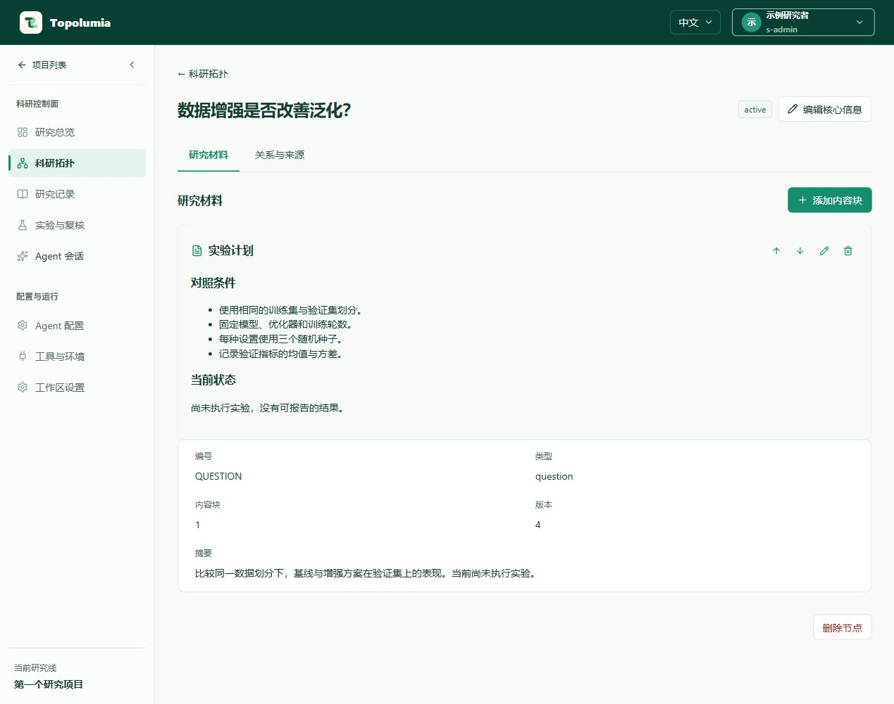
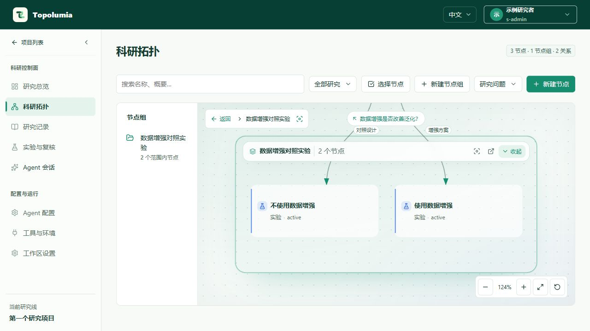
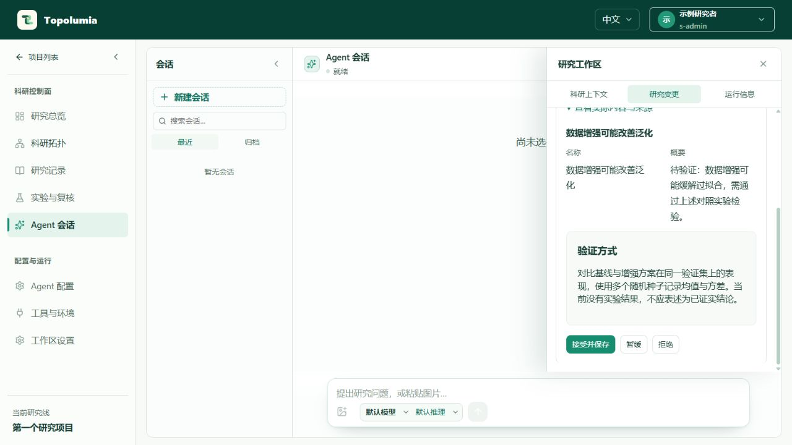

# 从空项目开始

本教程用“数据增强是否改善泛化？”演示建立研究问题、保存材料、审阅 Agent 提议与记录下一步。所有名称和截图都是合成示例，没有真实论文或实验结果。截图展示当前界面，示例候选由隔离夹具生成，不代表真实模型的研究输出。

Topolumia 处于探索开发阶段，当前主要用于本机运行。无需先配置 SSH、GPU、Conda 或实验跟踪服务；可以先完成人工创建与记录，再接入 Agent。

## 启动工作台

准备 Node.js 22.13+（推荐 22 或 24 LTS）、npm 和 Git，然后执行：

```sh
git clone https://github.com/Skydoge-zjm/Topolumia.git
cd Topolumia
npm ci
npm run build
npm start
```

打开 <http://127.0.0.1:5510>，保持终端里的服务运行。默认端口与修改方法见 [README](../../README.md#启动)；首次尝试无需复制或修改配置。

首次访问首页时选择“创建管理员账号”，填写显示名称、用户名和至少 12 个字符的密码，点击“创建并登录”。没有预设账号密码。已初始化的工作台使用自己的账号登录。

## 创建项目

在“项目列表”点击“创建项目”，填写：

| 字段 | 示例 |
| --- | --- |
| 项目 ID | `first-research` |
| 项目名称 | 第一个研究项目 |

点击“创建项目”进入工作台。以后从项目列表选择该项目继续；项目之间的科研对象、记录和 Agent 上下文隔离。

## 建立问题与材料

1. 打开“科研拓扑”，在新节点类型中选择“研究问题”，点击“新建节点”。
2. 节点名称填写“数据增强是否改善泛化？”，摘要写清要比较的条件和当前未知内容，点击“保存核心信息”。
3. 在节点详情的“研究材料”中点击“添加内容块”，标题填写“实验计划”，内容类型保留“文字 / Markdown”。
4. 填写下面的计划，点击“保存内容块”。

```markdown
## 对照条件

- 使用相同的训练集与验证集划分。
- 固定模型、优化器和训练轮数。
- 每种设置使用三个随机种子。
- 记录验证指标的均值与方差。

## 当前状态

尚未执行实验，没有可报告的结果。
```



内容块也可保存表格、图片、原文摘录、文件和链接。初次使用先保存文字即可；有来源材料时再添加出处、页码或图表定位，避免把计划、个人推断和已核实结果混在一起。

## 组织对照实验

返回“科研拓扑”，分别新建两个“实验”节点，命名为“不使用数据增强”和“使用数据增强”，摘要说明固定条件与唯一变化。

点击“新建节点组”，组名称填写“数据增强对照实验”，展开“选择成员”，勾选两个实验并保存。也可以在画布上先“选择节点”，再把所选节点组成节点组。

在问题节点的“关系与来源”中“添加关系”，选择实验节点和合适的关系类型。关系表示科研逻辑；节点组成员关系只表示组织归属，二者分开保存。画布支持展开、收起和聚焦节点组。



## 接入一个 Agent

先在运行 Topolumia 的机器安装并认证 Codex、Claude Code 或 OpenCode 中的一个 CLI。可参考各自的官方入口：[Codex](https://developers.openai.com/codex/cli/)、[Claude Code](https://code.claude.com/docs/en/overview)、[OpenCode](https://opencode.ai/docs/)。模型服务、账号权限和可能产生的费用由所选提供商决定。

进入“Agent 配置”，找到对应 Agent：

1. 点击“配置”，选择该运行时实际支持、且账号可用的模型并保存。项目默认模型不保证适用于所有提供商。
2. 点击“检查”，查看安装、认证及科研 MCP 状态；若失败，根据实际检查结果处理后重试。
3. 打开“Agent 会话”，点击“新建会话”，选择 Agent 适配器，填写标题并创建。

可以发送下面的任务：

```text
读取当前项目中“数据增强是否改善泛化？”的问题和实验计划。
请补充一条可检验假说，并通过 Topolumia 科研接口提交为待审候选。
明确区分计划和事实，不编造论文、训练指标或实验结果。
```

确认所选模型确实返回响应。配置检查通过只说明相应检查项可用，首次对话才验证模型响应。遇到问题可看 [Agent 排障](agent-debugging.md)。

## 审阅并保存提议

Agent 提交科研候选后，在会话中的“研究变更”查看；抽屉可在“本会话变更”和“项目变更”之间切换。展开“查看实际内容与来源”，核对对象、正文、来源和修改范围，向下滚动可看到处理按钮。



- 内容合适时选择“接受并保存”；保存后到“科研拓扑”或对象详情检查正文。
- 暂时无法判断时选择“暂缓”；不采用时选择“拒绝”。
- 如果版本冲突，先读取最新内容再决定，不重复覆盖已有研究材料。

“数据增强可能改善泛化”仍是一条待检验假说。接受候选表示将这份内容保存到项目，不表示科学结论已被证实。原生工具要求的命令、文件或网络授权是另一项操作，应根据执行影响单独决定。

如果对话只有自然语言总结、没有待审候选，可以要求 Agent 通过科研接口提交候选；普通回复不会自动成为正式科研材料。

## 记录下一步

进入“研究记录”：

- “科研历程”查看刚才的对象创建、材料修改和审批决定，点开条目可追溯实际变更。
- 在“纪要与记录”中点击“新建记录”，填写标题、正文和后续行动，例如“执行基线与增强方案的多种子对照实验”。活动类型可选“实验复盘”，尚未完成的记录保存为草稿。
- 回到“研究总览”，检查当前对象、待审内容和行动；尚未执行的实验不会产生真实训练指标。

到这里，你已经有一个研究问题、明确的实验计划、可组织的对象和一份可追溯记录。后续接入 Python、SSH 或外部运行数据时，再看 [工具与环境需求](../product/requirements/tools-and-environments.md) 与 [运行维护](operations.md)。

## 保存与排障

应用数据默认保存在 runtime，科研工作目录与应用数据分开。备份前正常关闭服务，并同时保存数据库、资产与相关工作文件；具体范围见 [数据与存储](../technical/architecture/data-and-storage.md) 和 [备份方法](operations.md#备份)。不要为了重试初始化而删除真实数据目录。

启动失败或页面打不开时，先查看终端错误、Node.js 版本与实际监听端口。需要反馈时使用 [Bug 模板](https://github.com/Skydoge-zjm/Topolumia/issues/new?template=bug_report.yml)，仅附脱敏的最小复现、日志和截图。疑似安全漏洞按 [安全报告说明](../../SECURITY.md) 私下报告。
