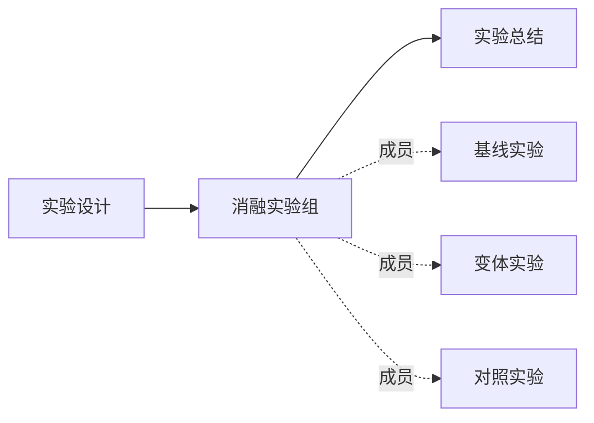

# 节点组

节点组是一组相关科研对象的持久集合，也可以作为整体被引用、连接和解释。研究者只需要一个“节点组”概念；整理、筛选、收起以及承载研究语义是同一对象逐步使用的能力。

本业务定义与实现范围见 [需求](../requirements/node-groups.md)。共同模型见 [科研模型](research-model.md)，实现机制见 [节点组模块](../../technical/modules/node-groups/README.md)。

## 最小身份与自由材料

创建时只需组名称，允许先建空组再加入成员。说明、类别、标签、成员角色和内容块均可选，不要求先选择“组织”或“研究”类型。

类别只是描述，如文献集合、消融实验、参数比较或研究主题，可使用自定义文本。类别不改变组的权限、可用关系、内容块或必填条件。

组沿用类型核心与自由内容分层：核心识别这一集合，内容块保存用户自行命名和组织的协议、比较表、图像、总结及其他材料。组拥有自己的正文；成员正文仍归成员，不能加入组时自动复制或拼成另一份正文。

组级总结与独立总结节点都合法。只有需要将总结独立引用或参与更多推理时，才由研究者创建或关联节点；不强制每组都有设计或总结节点。

## 成员与层级

一个节点可以加入多个组。同一组内同一节点只保留一份成员关系。成员可具有自定义角色和简短说明，例如 baseline、control、variant；角色只在当前组内生效，不会改写节点本身的类型或状态。

组可以有一个父组，形成无环层级。父组的研究范围包含直接成员及后代组成员，范围计数按节点身份去重；直接成员、子组、递归范围分别可查。一个节点出现在多层或多个子组时，保留实际加入位置和角色来源，不自动继承角色。

父子关系和成员关系表达组织范围。它们不会自动生成“支持”“产生”“比较”等科研逻辑关系，也不表示组整体的每个判断都适用于每一成员。

调整成员或移到另一父组是正式科研组织变更。展开、收起、当前筛选与画布位置是个人浏览状态。

## 组作为正式关系端点

科研关系可以连接节点或组。节点与组身份不同，组在展开和收起时始终是同一个关系端点。

虚线仅解释成员关系；画布实现应使其与正式逻辑边可区分。

设计连接组，表达设计面向整个集合；不自动展开成设计分别连接每个实验。成员之间和成员对外的关系可以另外存在，不能被组关系覆盖。

允许节点→组、组→节点和组→组。所有端点必须存在于同项目，不能直接连接自己。组与自身成员的显式逻辑关系也合法，但不能由成员关系推断。

## 主入边和主出边

每组可以从真实的组关系中各指定一条主入边和主出边。例如设计→实验组可为主入边，实验组→总结可为主出边。

两项均可留空，也不限制其他关系数量。主边只是研究者对关系重点的选择，不是另一套边，也不规定相邻节点必须是某种类型。调整主边不会创建或删除关系。

画布可以突出主边；其他正式边及成员对外边仍能看到和展开核对。界面和 Agent 均需区分“直接连接组的关系”与“从组内成员投影出的关系”。

## 展开、收起与重叠

组在收起与展开时始终呈现为容器。收起容器保持有限尺寸，内部小点代表成员，并尽量对应展开布局；点击容器即可展开。展开后成员以正常节点呈现在容器边界内，镜头对准容器，四周保留通向外部对象的连线空间。收起时恢复之前的镜头与位置，关系事实及成员身份不随浏览状态变化。

成员边投影到组上时，保留原始端点、关系 ID、类型、方向和数量，不伪装成研究者明确建立的组关系。组内边可在收起时隐藏，但必须可计数和继续查看。

多个互不包含的收起组共享一个成员时，共享节点保留可见，并提示所属组；收起组与展开组的直接共享成员也保留可见。不按组名或 ID 把它随意归给某一组。组分别显示完整范围数、实际收起数与共享成员数。

研究者可以聚焦一个组，在局部视图查看其完整范围和外部连接。搜索命中收起成员时可临时揭示路径，不改变持久成员关系或个人原有收起设置。

## 生命周期

移除成员只解除当前组的直接成员关系；节点若仍经子组属于该范围，应明确显示这一原因。修改递归范围需要编辑实际所属子组。

删除组保留所有成员节点和子组，子组提升到被删组的父组，无父组时成为根组。组自己的逻辑边被移除，不改接成员；其他组的成员关系不受影响。

删除节点时，清理它在各组的直接成员关系。历史中保留当时的组信息、角色、关系和材料依据，不能让删除动作抹掉研究过程。组内容的文件保留遵循共享 [科研文件生命周期](../../technical/modules/content-blocks/file-lifecycle.md)。

组编辑、成员调整、组材料和组关系遵守 [科研变更规则](research-changes.md)：人工按权限直接操作，Agent 提出候选，由人类审批。
