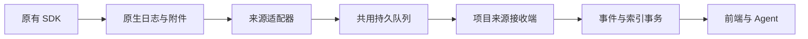

# 实验记录与来源

实验节点表达可复现的结果单位，只保存结果表格、图片或指标也是完整用法。可选的 experimentRecord 内容块承载过程工作台。业务见[科研模型](../../../product/business/research-model.md#实验与-run)，操作与验收见[工作区需求](../../../product/requirements/research-workspace.md#实验记录块归属)。平台读取已有记录，不启动训练或替代训练 SDK。

## 内容块归属

[experiment-records.ts](../../../../src/domain/research/experiment-records.ts) 定义块内 run 和材料关联。每个记录块拥有独立集合，集合身份等于块身份；独立表保存小型元数据，累计事件、点和附件独立持久化。普通实验节点不再持有 runs/materialLinks/experimentRevision，也不挂载全局运行栏或原始数据页。静态导入保留各块执行身份；托管项目来源由块显式选择引用，不复制累计数据。

[共同变更](../../../../src/services/research/changes/experiment-mutations.ts) 的 editExperiment 必须携带目标 blockId 和集合观察版本。人工修改沿用统一事务、历史与冲突反馈；Agent 使用 nodeChanges.recordBlockId/experimentPatch 提议，不能直接修改科研对象。块中导入记录、手动运行元数据和材料引用都进入固定的块版本；连续接收的观察使用独立数据水位。

[对象仓库](../../../../src/services/research/objects/repository.ts) 对已有节点级记录做一次事务交接，先保留原节点和内容块的完整备份，再将执行和关联归入各记录块。历史对象快照与原始资产保留；后续只读写新合同，没有长期双写。多个旧块曾共用一个 run 时保留其历史引用，精确读取须指定 blockId。

## 原始导入与解码

[ExperimentRecordImporter](../../../../src/services/research/experiments/record-importer.ts) 支持归档的 .wandb、TensorBoard event 和 JSON/JSONL。上传字节沿用[资产生命周期](../content-blocks/file-lifecycle.md)，不可变原件和派生索引分开；原件改变或缺失报告错误。配置、命令、YAML、日志、最终表格继续使用普通内容块。

每项目惰性创建一个[后台解析线程](../../../../src/services/research/experiments/record-worker.ts)，处理静态解析、采样和表格范围。主线程只接收小目录或请求范围。同资产任务合并；后台数值缓存按序列化体积计费 64 MiB，主线程目录缓存最多 256 项、8 MiB。超过缓存额度仍可读取，不代表整个进程堆内存受此上限约束。静态派生目录为 experiment-record-v3，按当前解析语义重建索引，保留原件。

JSON 导出保留 sourceId/id/runId/run_id 的运行身份、config/params 与完整 summary 事件；缺省事件序号和来源身份由原始运行补齐。按指标组织的观察支持 timestamp 与 wall_time，重复和回退坐标不改变原生时间。

[Python 静态读取器](../../../../scripts/runtime/experiment-record-parser.py) 与采集器复用[原生适配器](../../../../scripts/runtime/topolumia_collector/adapters.py)。W&B 容器读取保留[上游 MIT 声明](../../../../scripts/runtime/wandb_record_reader.py)；TensorBoard 使用原生 Event protobuf 和官方 CRC 实现读取 TFRecord 完整边界。静态读取器由 experimentRecords.pythonCommand 指定，依赖见[读取器依赖](../../../../requirements/experiment-record-readers.txt)。JSON 导入不要求 Python。

静态导入同时写入与持续接收共用语义的 `experiment-record-events.v1` 事件索引；W&B/TensorBoard 的配置、摘要、媒体、分布、文件、生命周期和未知扩展可通过同一个 `read_experiment events` 查询。事件正文过大时返回预览和精确范围 readHint，原生附件仍独立下载；旧索引首次访问富事件时会在后台解析器中补建该事件索引。

### MLflow 服务导入

[MLflow 读取器](../../../../src/services/research/experiments/mlflow-reader.ts)读取实验目录、运行元数据、全部指标历史分页和产物目录，保留原生观察顺序、重复和回退 step。Protobuf JSON 中的 NaN、Infinity、-Infinity 字符串在读取边界解码为 float64 类型值，准确读取保留这些观察，画布只绘制有限值。配置的实验 ID 或名称约束导入范围；目录超过配置上限、分页游标重复或任一请求失败均明确报错，不返回静默截断的成功结果。

项目管理者在训练记录页选择“从 MLflow 导入”，服务连接沿用工具与环境中的 MLflow 配置。GET /api/research/experiments/mlflow/catalog 返回可选运行，POST /api/research/experiments/mlflow/import 接收 runIds。[导入服务](../../../../src/services/research/experiments/mlflow-importer.ts)先读完整个选择，再在同一个 SQLite 事务中保存项目来源和统一事件；参数、标签、摘要、原生运行元数据、全部标量和产物清单进入同一持久记录模型。产物保留外部目录元数据，文件内容仍需按原生服务的访问方式取得；不把未下载的产物标为本机附件。Agent 与采集凭据不能导入或浏览服务目录。

相同原始内容重复导入幂等；上游内容变化产生新的不可变项目来源版本，已有记录块和快照继续引用原版本。导入后可按同一训练记录目录选择、归入实验、读取准确数据和固定快照，后续读取不依赖 MLflow 在线。MLflow 能力为读取导入，不向上游写入训练结果。

实验查询统一使用持久项目来源或资产原件；不再维护服务快照网关、内存 metric store、模拟训练 overlay 或独立服务曲线采样。Git 与文件来源刷新只更新相应来源索引。单独的历史 run 引用不提供记录数据，新建记录块必须选择持久来源或实际原文件。

### 当前格式范围与已知缺口

W&B 按 _type 子树排除图片宽高、表格行数等元数据，自定义 metric/通配定义及 step_sync 决定横轴。commit 与磁盘 flush 不等价，采集只能呈现已落盘记录。TensorBoard 保留全部观察及 session/restart 记录，不自动 purge，不按 step 去重或排序。重复和回退坐标均保留。

持续合同使用带 dtype 的数值保存 int64/uint64、float32/64、NaN/Inf。准确范围返回原类型，画布仅绘制可表示的有限数值；大整数的画布位置采用近似值，准确表格保留十进制字符串。静态原生索引同时保存显示数值与原始带类型值，原件仍可下载。

持续来源的配置/摘要更新与删除、表格版本/分段、分布、媒体引用、生命周期及未知插件均保留。界面提供配置/摘要、有限表格和分布预览，以及原文件下载；HTML、Plotly、图结构、embedding、Artifact 等高级插件的原生数据不等于原生交互渲染。单个容器不包含全部附件；缺依赖、超额度和不支持预览必须明确显示。云服务协议、框架 autolog、DDP/shared 和跨版本支持不由本轮样本推定。

## 材料与运行对应

[ExperimentRecordService](../../../../src/services/research/experiments/record-service.ts) 按记录块/集合、run、材料块版本及具体选择保存关联。整块、文件、内联行和上传表格物理行都可选择；后续编辑不改写旧关联。内联 rowIndex 从数据首行计数，不含表头；assetRow 从原文件首行计数，包含表头。

人工关联文件行前读取实际范围；Agent 必须取得对应工作表和行的读取回执。分页回执只覆盖实际交付的 run、关联及材料范围。自己提议的新记录和材料可以在同一候选中增量关联。持续来源的 run 可关联普通配置/日志块；人工标签、状态和备注修订仍经共同变更，不能借采集凭据写入。

## 持续接收

默认部署为用户电脑或自有服务器运行 Topolumia 后端与存储，训练机运行原生 SDK、本地文件与采集器。两者可同机；远程需 HTTPS 或 SSH 隧道。W&B offline 和 TensorBoard 均无需第三方账号。

### 合同与权限

[record-ingestion.ts](../../../../src/domain/research/record-ingestion.ts) 是 v1 接收合同的权威；GET /api/schemas/record-ingestion 提供 JSON Schema，块接收端 capabilities 提供大小、编码和呈现能力。单批最多 128 个事件，采集器默认 128 个，避免大批事务阻塞交互。稳定事件身份由 streamId、writerId、generation 和 seq 组成，独立于横坐标；来源携带适配器/SDK 版本。相同事件重试幂等返回，同身份异内容整批冲突并回滚，序号缺口拒绝并返回期望位置，旧批重试不回退确认点。

环境托管部署维护项目来源授权，逐次检查授予者当前权限。采集凭据仅允许指定来源的能力查询、批次和附件提交，不能改变科研归属或修改对象。细节见[权限架构](../../architecture/authorization.md#实验采集授权)。

### 持久接收与查询

[RecordIngestionService](../../../../src/services/research/experiments/record-ingestion.ts) 在 SQLite FULL 事务内同时写入可重放事件、来源、run 目录及标量范围索引，提交后 ACK。事件正文保留原始来源封装；rebuild 可从事件重建目录/点/附件引用。没有独立文件日志与数据库之间的确认窗口。持久与可查询水位分别返回，首版在同一事务内相等；附件齐全独立反馈。详见[存储与快照](../../architecture/data-and-storage.md#实验连续记录存储)。

点按观察序号建立索引，准确页最多 100 点/指标，不扫描之前的累计前缀；每 128 点维护一个增量极值摘要，采样读取小型摘要及快照尾部，受每图和总体点数预算约束。附件按 SHA-256 独立流式写入、校验、同步落盘并登记，单附件上限 64 MiB；文件提交前后仍检查授权。重试不复制原件，附件慢不阻断标量确认。

固定快照保存数据水位、科研块/材料版本、run 目录及附件清单。后续追加、改标签、归档记录块或删除节点都不改变快照中的读取依据；项目权限仍检查。停止采集或撤销凭据不授权删除已收数据。

### 托管采集

“工具与环境”按主机展示 W&B/TensorBoard 适配器，复用 SSH 登录和远端项目目录；平台部署独立 Python 读取环境、管理后台进程、私有凭据和传输。项目范围默认使用项目目录，附加路径按项目和主机持久化。普通操作不下载脚本、不要求用户维护终端或填写服务地址。接入入口统一在环境页，实验块选择项目记录或导入文件。

[项目记录目录](../../../../src/services/research/experiments/project-records.ts)按项目及过滤条件执行 SQL 分页，只反序列化请求页；显式运行读取走主键，浏览目录不解析全部科研材料或累计点。项目来源与记录块分离：来源持有原生运行及累计事件，块保存显式运行选择和可选专属目录规则；新 run 默认未归属。同一来源可由多个块明确引用，存储不复制。查询按块选择过滤运行、事件和附件，快照固定来源水位及选择，目录改动与后续追加不改变已固定范围。

[Python 采集器](../../../../scripts/runtime/topolumia_collector/cli.py) 与[共用队列](../../../../scripts/runtime/topolumia_collector/spool.py) 保留原生游标、解释上下文、稳定序号及附件事务；ACK 后推进确认点，默认积压额度 128 MiB，额度不足暂停读取。适配器仅负责原生解码，身份、归档、队列和重试由公共运行时承担；覆盖/截断建立新 generation，半条记录等待，完整坏校验报告错误。原生文件按 4 MiB 完整前缀分段归档，媒体依赖独立处理。

具体部署入口、进程生命周期和环境权限见[工具与环境模块](../tools-and-environments/README.md)。

## 界面与 Agent

[ExperimentWorkbench](../../../../frontend/src/features/experiments/ExperimentWorkbench.tsx) 挂载在记录块中。记录栏提供来源、跟随状态、版本选择、管理菜单和全屏；运行台账同时控制曲线的显示、独看和悬停高亮，展开行显示来源及关联材料。曲线、数据表、事件与附件使用分段切换，普通块编辑、排序、归档、草稿与冲突机制仍共用。选择训练记录、导入、手工添加运行及固定版本集中在管理菜单；部署、授权和进程状态统一在工具与环境管理。“实时跟随”表示界面读取水位，不证明采集器在线。“固定当前版本”保留分析依据并打开数据表。

版本选择适用于运行目录、台账数值、曲线、事件及附件下载/预览。切换快照时按新身份等待数据，不能将上一版本数值放在新的版本标签下；同一最新版本的水位刷新保留已有曲线与操作状态。事件分页在版本切换时重置，附件请求携带相同 snapshotId。

[ExperimentPlots](../../../../frontend/src/features/experiments/ExperimentPlots.tsx) 使用 uPlot 独立横轴序列和 run 身份颜色，支持同步十字线/数值、框选与按钮缩放，并按指标前缀分组。展示可平滑、切换对数轴和调整每行图数；非正值指标保留线性轴并标注。数据追加用 setData 更新同一实例，保留已锁定的视口；离屏画布释放并保存范围。版本轮询只读小水位，每 2 秒一次，离屏/后台降低更新；暂停与回到最新不改变采集。原始准确数据在数据表中读取。

[useFilteredExperimentPlot](../../../../frontend/src/features/experiments/useFilteredExperimentPlot.ts) 供记录块与临时比较共用：初次读取最多 32 项曲线及完整指标目录，筛选命中未载入的指标时按目录请求最多 32 个匹配指标。完整目录在请求期间保留，不能把默认省略的指标误报成不存在；同一读取范围内的刷新可保留结果，跨快照或对象版本不能复用占位数值。

[ExperimentDataWorkspace](../../../../frontend/src/features/experiments/ExperimentDataWorkspace.tsx) 默认显示前 12 项，最多 24 项，每页一次请求获取各列 100 点；目录/点版本分别校验。key 与 xKey 共同确定系列。表头/横坐标冻结，数据行虚拟化，复制包含当前页全部行和原始精度；重复坐标保留，不补零或插值。

拓扑与节点入口解析所选实验中的实际记录块，临时比较全部 run，超过 24 次也不截断；只叠加完全同名指标，来源和块身份保留。无过程记录的实验返回空范围，不造 run。分析保存在研究笔记，不保存比较对象。

`read_experiment` 经共同 MCP/CLI/HTTP 提供 available/runs/materials/metrics/series/inspect/compare/snapshot/events。available 按主机、工具、名称和未归属状态分页发现项目记录，返回 projectSource 供候选绑定；具体数据先定位块，再读目录及准确范围；大事件目录有明确预览限制，按 eventWatermark 和文本范围读取原文。记录附件通过 transfer_asset 的 recordAttachment 目标下载，遵守同一会话交接目录规则。分析前固定快照，把 experimentSnapshot sourceRef 写入候选笔记。精确参数以 [tools.ts](../../../../src/domain/research/interfaces/tools.ts) 为准。

## 验证

- [记录回归](../../../../tests/research/experiment-records.test.ts)：独立集合、候选与观察范围、材料历史和跨实验比较。
- [持续接收回归](../../../../tests/research/record-ingestion.test.ts)：ACK 重试/重启、原始类型、快照、权限、附件、准确范围与采样。
- [MLflow 持久导入回归](../../../../tests/experiments/mlflow-records.test.ts)与[真实服务集成](../../../../tests/experiments/mlflow-records.integration.ts)：完整分页、幂等、不可变版本、重启、快照、权限和失败原子性。
- [队列回归](../../../../scripts/testing/test-experiment-collector.py)：半条记录、覆盖代际、确认丢失、恢复和额度计数。
- [原生导入集成](../../../../tests/research/experiment-records.integration.ts)、[WSL 验证器](../../../../scripts/integration/verify-record-ingestion-wsl.mjs) 与[合成训练](../../../../scripts/integration/simulate-record-server.py)：真实 SDK、训练中增长、远程 HTTP、离线队列、后端重启、类型与附件。
- [浏览器流程](../../../../frontend/e2e/experiment-records.spec.ts)、[大数据浏览器](../../../../frontend/e2e/experiment-performance.spec.ts) 与[接收性能脚本](../../../../scripts/diagnostics/benchmark-record-ingestion.mjs)：交互、窄屏、离屏释放、稳定视口、准确范围和有界渲染。

测试准备与研究样本范围见[测试指南](../../../playbooks/testing.md#实验生态记录调研)。全部运行数据查询使用同一个持久记录模型。
